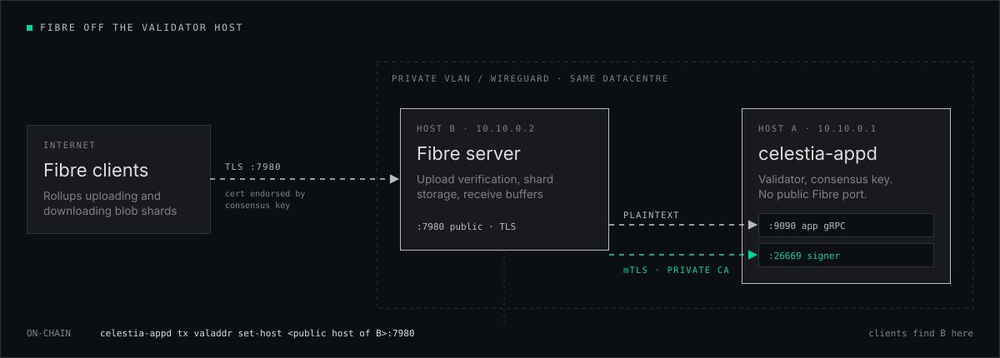

<a href="https://astrosynx.org/tech">
  
</a>

<p>
  <a href="https://astrosynx.org/"></a>
  <a href="https://astrosynx.org/tech"></a>
  <a href="https://astrosynx.gitbook.io/services/documentation/mainnet-guides/celestia"></a>
  <a href="https://astrosynx.org/decentralization-celestia"></a>
</p>

Public infrastructure for Celestia operators, run by [Astrosynx](https://github.com/astrosynx) on our own hardware. It covers consensus endpoints and snapshots for mainnet and Mocha, a state sync recipe, and a field guide to running Fibre on a separate host.

**Contents:** [Endpoints](#endpoints) · [Snapshots](#snapshots) · [State sync](#state-sync) · [Fibre](#fibre) · [Quick checks](#quick-checks) · [Common errors](#common-errors)

<br>

## Endpoints

| | Mainnet | Mocha testnet |
|---|---|---|
| **Chain ID** | `celestia` | `mocha-5` |
| **RPC** | [`celestia-mainnet-rpc.astrosynx.com`](https://celestia-mainnet-rpc.astrosynx.com/) | [`celestia-testnet-rpc.astrosynx.com`](https://celestia-testnet-rpc.astrosynx.com/) |
| **gRPC** | `celestia-mainnet-grpc.astrosynx.com:443` | `celestia-testnet-grpc.astrosynx.com:443` |
| **API** | [`celestia-mainnet-api.astrosynx.com`](https://celestia-mainnet-api.astrosynx.com/) | [`celestia-testnet-api.astrosynx.com`](https://celestia-testnet-api.astrosynx.com/) |
| **Peers, seeds, addrbook** | [GitBook ↗](https://astrosynx.gitbook.io/services/documentation/mainnet-guides/celestia/public-endpoints-and-peering) | [GitBook ↗](https://astrosynx.gitbook.io/services/documentation/testnet-guides/celestia/public-endpoints-and-peering) |
| **Full guide** | [Mainnet services ↗](https://astrosynx.gitbook.io/services/documentation/mainnet-guides/celestia) | [Testnet services ↗](https://astrosynx.gitbook.io/services/documentation/testnet-guides/celestia) |

<br>

## Snapshots

| | Mainnet | Mocha testnet | Every | Pruning | Indexer |
|---|---|---|---|---|---|
| **Pruned** | [`mainnet-snap…/celestia/`](https://mainnet-snap.astrosynx.com/celestia/) | [`testnet-snap…/celestia/`](https://testnet-snap.astrosynx.com/celestia/) | 4 hours | `custom: 100/10` | `null` |

For a validator or RPC node, the pruned snapshot or [state sync](#state-sync) is faster.

<br>

## State sync

State sync downloads a recent state snapshot from peers instead of replaying every block, so a fresh node usually catches up within minutes. The node has no block history from before the trust height.

> For Mocha, use `SNAP_RPC="https://celestia-testnet-rpc.astrosynx.com:443"`.

```bash
# 1. Stop the node and back up the validator state
sudo systemctl stop celestia-appd
cp $HOME/.celestia-app/data/priv_validator_state.json $HOME/priv_validator_state.json.backup

# 2. Reset data (keys and address book are kept)
celestia-appd tendermint unsafe-reset-all --home $HOME/.celestia-app --keep-addr-book

# 3. Get a trusted height and hash from the Astrosynx RPC
SNAP_RPC="https://celestia-mainnet-rpc.astrosynx.com:443"
LATEST_HEIGHT=$(curl -s $SNAP_RPC/block | jq -r .result.block.header.height)
TRUST_HEIGHT=$((LATEST_HEIGHT - 2000))
TRUST_HASH=$(curl -s "$SNAP_RPC/block?height=$TRUST_HEIGHT" | jq -r .result.block_id.hash)
echo "trust_height: $TRUST_HEIGHT  trust_hash: $TRUST_HASH"

# 4. Enable state sync in config.toml (only inside the [statesync] section)
sed -i \
  -e '/^\[statesync\]/,/^\[/ s|^enable *=.*|enable = true|' \
  -e "/^\[statesync\]/,/^\[/ s|^rpc_servers *=.*|rpc_servers = \"$SNAP_RPC,$SNAP_RPC\"|" \
  -e "/^\[statesync\]/,/^\[/ s|^trust_height *=.*|trust_height = $TRUST_HEIGHT|" \
  -e "/^\[statesync\]/,/^\[/ s|^trust_hash *=.*|trust_hash = \"$TRUST_HASH\"|" \
  $HOME/.celestia-app/config/config.toml

# 5. Restore the validator state and start
mv $HOME/priv_validator_state.json.backup $HOME/.celestia-app/data/priv_validator_state.json
sudo systemctl restart celestia-appd && sudo journalctl -u celestia-appd -f -o cat
```

Once the node has caught up, switch state sync off so that a later restart does not trigger it again:

```bash
sed -i '/^\[statesync\]/,/^\[/ s|^enable *=.*|enable = false|' $HOME/.celestia-app/config/config.toml
```

> [!TIP]
> If the node keeps logging `discovering snapshots` and nothing happens, it has no peers that serve snapshots. Add our peers from the [peering page](https://astrosynx.gitbook.io/services/documentation/mainnet-guides/celestia/public-endpoints-and-peering) to `persistent_peers`, or use a [snapshot](#snapshots) instead.

<br>

## Fibre

<a href="./fibre/README.md"></a>

Fibre is the data-availability service introduced with app v10. It is **live on Mocha**, and mainnet is still on app v9. Running Fibre on the validator machine works, but under load its receive buffers (about 27 GiB at default limits), upload verification and blob traffic compete with consensus. It also puts a public port on the host that holds the consensus key.

**[→ Running Fibre on a separate host](./fibre/README.md)** is our guide to the split setup. It covers a private VLAN or WireGuard, a private CA and mTLS for the signer, firewall rules, a cutover order that keeps the validator signing, and the `valaddr set-host` step that is easy to forget.

<br>

## Quick checks

```bash
# Node status through our RPC
celestia-appd status --node https://celestia-mainnet-rpc.astrosynx.com:443

# Latest block through the REST API
curl -s https://celestia-mainnet-api.astrosynx.com/cosmos/base/tendermint/v1beta1/blocks/latest | jq .block.header.height

# Active app version (10 = Fibre available)
curl -s https://celestia-mainnet-rpc.astrosynx.com/abci_info | jq -r .result.response.app_version

# Local binary version and staking parameters
celestia-appd version
celestia-appd query staking params --node https://celestia-mainnet-rpc.astrosynx.com:443
```

<br>

## Common errors

| Error | Cause | Fix |
|---|---|---|
| `insufficient fees` | The transaction fee is too low | Raise `--fees` when you delegate or send transactions |
| `failed to connect to RPC` | The RPC is unavailable or blocked by a firewall | Check the URL and open the ports you need (443, 26657, and 26658 for celestia-node) |
| `snapshot not found / download failed` | The URL is unavailable or the snapshot was rotated | Pick the latest file from the listing, or use the archive snapshot |
| `node stuck / not syncing` | Bad peers or corrupted data | Back up `data/priv_validator_state.json`, run `celestia-appd tendermint unsafe-reset-all --home ~/.celestia-app --keep-addr-book`, then restore from a snapshot or [state sync](#state-sync). **Never delete the whole `~/.celestia-app` directory**, because `config/` holds your validator and node keys |
| `permission denied` | The node user cannot access the directory | Run commands as the user that owns `$HOME/.celestia-app`, or use `sudo` carefully |

<br>

---

<sub>Maintained by <a href="https://github.com/astrosynx">Astrosynx</a>, on mining and compute infrastructure we have run since 2017 · <a href="https://astrosynx.org/">astrosynx.org</a> · <a href="https://astrosynx.org/tech">Operator hub</a></sub>

